# Hibernate / JPA Association Mappings — Complete Student Notes

**Java 21 | Spring Boot 3 | Spring Data JPA | Hibernate | PostgreSQL | Maven**  
**Examples:** Employee ↔ EmployeeProfile, Department ↔ Employee, Customer ↔ Product  
**Learning outcomes:** understand definitions, cardinality, ownership, foreign keys, join tables, annotations, SQL execution, persistence lifecycle, API architecture, testing, and performance.

---

## 1. What is association mapping?

**Definition:** Association mapping is the process of mapping a relationship between two or more Java entity classes to a relationship between relational database tables, using Jakarta Persistence (JPA) annotations. Hibernate is an ORM provider that implements the mappings.

An *entity* represents a persistent domain object. An *association* represents a reference from one persistent entity to another (or a collection of other entities).

**Example:** `Employee` has an `EmployeeProfile`; an `Employee` belongs to a `Department`; `Customer` entities can purchase many `Product` entities.

Without ORM association mapping, applications would manually maintain foreign-key values, write JOIN queries, and reconstruct related objects. Mappings allow navigation such as `employee.getDepartment().getName()` **while the persistence context is open** (and with a query if necessary).

### Why use association mappings?

1. Represent real-world business relationships in an object-oriented domain model.
2. Connect database foreign keys/join tables to Java object references.
3. Reduce repetitive association-management SQL and mapping code.
4. Support relational integrity through primary keys, foreign keys, and unique constraints.
5. Navigate related data in either or both directions, if modeled.
6. Coordinate persistence operations through cascading when appropriate.
7. Control when related data is loaded (`LAZY`/`EAGER`).
8. Write JPQL queries and fetch joins against entity relationships.

**Important:** mappings are not automatically faster than SQL. Incorrect fetch strategies, excessive cascades, and large collections can degrade performance.

## 2. Relationship types at a glance

| Mapping | Meaning | Example | Database representation |
|---|---|---|---|
| `@OneToOne` | One row corresponds to at most one row | Employee ↔ EmployeeProfile | Unique foreign key or shared primary key |
| `@OneToMany` | One parent can have many children | Department → Employees | `department_id` foreign key in `employees` |
| `@ManyToOne` | Many children refer to one parent | Employee → Department | Same `department_id` foreign key |
| `@ManyToMany` | Many entities on both sides | Customers ↔ Products | `customer_products` join table |

### Combined conceptual diagram

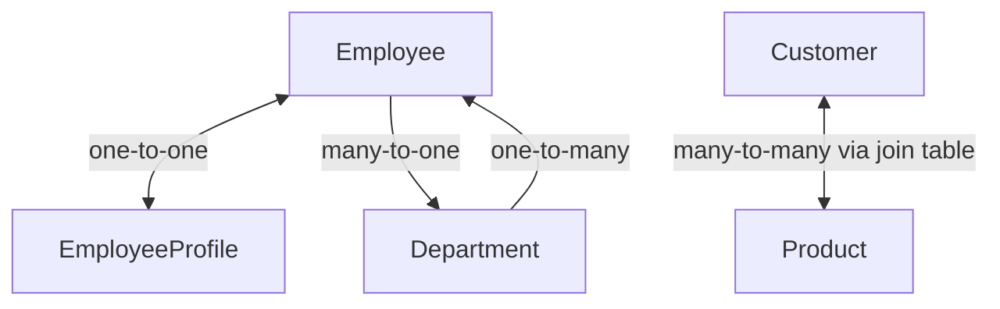

> **Cardinality** is different from **navigation direction**: one-to-many describes how many records relate; unidirectional/bidirectional describes which Java objects have references to the other side.

---

## 3. Prerequisites and project architecture

### 3.1 Spring Boot layered architecture

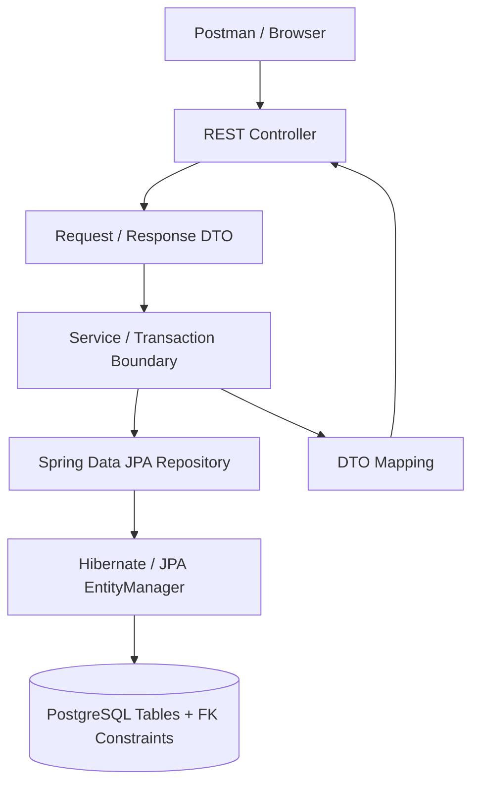

Typical request execution:

1. `POST /api/departments` reaches the controller.
2. Controller validates/parses request DTO.
3. Service loads or creates entities and sets both sides of bidirectional relationships.
4. Repository calls `save()`; Hibernate tracks entity state.
5. On flush/transaction commit, Hibernate issues SQL INSERT/UPDATE/DELETE statements.
6. PostgreSQL checks foreign keys and unique constraints.
7. Controller returns a **DTO**, not a raw bidirectional entity graph.

### 3.2 Suggested Maven dependencies

```xml
<dependencies>
    <dependency>
        <groupId>org.springframework.boot</groupId>
        <artifactId>spring-boot-starter-web</artifactId>
    </dependency>
    <dependency>
        <groupId>org.springframework.boot</groupId>
        <artifactId>spring-boot-starter-data-jpa</artifactId>
    </dependency>
    <dependency>
        <groupId>org.postgresql</groupId>
        <artifactId>postgresql</artifactId>
        <scope>runtime</scope>
    </dependency>
    <dependency>
        <groupId>org.springframework.boot</groupId>
        <artifactId>spring-boot-starter-test</artifactId>
        <scope>test</scope>
    </dependency>
</dependencies>
```

Use a Java 21 compatible, currently supported Spring Boot 3.x patch release from Spring Initializr; the Spring Boot parent manages compatible dependency versions. No Lombok is required.

**application.properties** (local learning environment):

```properties
spring.datasource.url=jdbc:postgresql://localhost:5432/association_demo
spring.datasource.username=postgres
spring.datasource.password=your_password
spring.jpa.hibernate.ddl-auto=update
spring.jpa.show-sql=true
spring.jpa.properties.hibernate.format_sql=true
logging.level.org.hibernate.orm.jdbc.bind=TRACE
```

Create database:

```sql
CREATE DATABASE association_demo;
```

**Production note:** prefer Flyway or Liquibase migrations over `ddl-auto=update`; do not put production secrets into source control.

### 3.3 Common imports for examples

Entity examples below use:

```java
import jakarta.persistence.*;
import java.util.*;
```

Entity classes should have a no-argument constructor and appropriate accessors. To keep the lesson focused, selected snippets omit repetitive getters/setters; the **code skeletons show the mapping and relationship-management methods**. Add standard getters/setters when creating runnable classes.

---

# PART A — ONE-TO-ONE

## 4. `@OneToOne`: Employee and EmployeeProfile

### 4.1 Definition and real-world usage

A **one-to-one relationship** associates one `Employee` with **at most one** `EmployeeProfile`, and a profile belongs to one employee.

Use it when the related data is logically a separate entity and should not simply be fields in the same table. Examples include Employee–Profile, User–Settings, and Person–Passport (subject to domain rules).

**Design decision:** Two tables can improve lifecycle separation or access control, but are not necessary for every group of fields.

### 4.2 Database design: foreign key + unique constraint

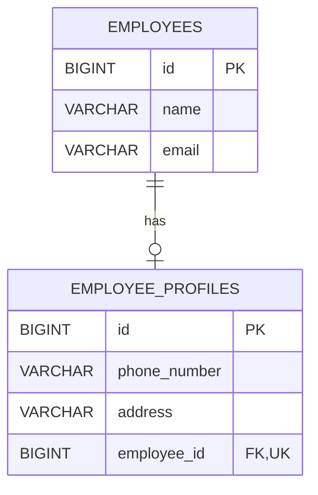

- `employee_profiles.employee_id` references `employees.id`.
- `UNIQUE(employee_id)` prevents two profiles referencing the same employee.
- `NOT NULL` can require every profile to have an employee; it **does not** ensure every employee has a profile.

**PostgreSQL schema (illustrative):**

```sql
CREATE TABLE employees (
    id BIGINT GENERATED BY DEFAULT AS IDENTITY PRIMARY KEY,
    name VARCHAR(100) NOT NULL,
    email VARCHAR(150) NOT NULL UNIQUE
);
CREATE TABLE employee_profiles (
    id BIGINT GENERATED BY DEFAULT AS IDENTITY PRIMARY KEY,
    phone_number VARCHAR(30),
    address VARCHAR(255),
    employee_id BIGINT NOT NULL UNIQUE,
    CONSTRAINT fk_profile_employee FOREIGN KEY (employee_id)
        REFERENCES employees(id)
);
```

### 4.3 Bidirectional mapping: Employee (inverse side)

```java
package com.javacodeex.association.entity;
import jakarta.persistence.*;

@Entity
@Table(name = "employees")
public class Employee {
    @Id
    @GeneratedValue(strategy = GenerationType.IDENTITY)
    private Long id;
    private String name;
    @Column(unique = true)
    private String email;

    @OneToOne(mappedBy = "employee",
              cascade = CascadeType.ALL,
              orphanRemoval = true,
              fetch = FetchType.LAZY)
    private EmployeeProfile profile;

    protected Employee() {}
    public Employee(String name, String email) {
        this.name = name;
        this.email = email;
    }
    public Long getId() { return id; }
    public String getName() { return name; }
    public String getEmail() { return email; }
    public EmployeeProfile getProfile() { return profile; }

    // Keeps both Java references synchronized
    public void setProfile(EmployeeProfile next) {
        if (this.profile == next) return;
        if (this.profile != null) this.profile.setEmployeeInternal(null);
        this.profile = next;
        if (next != null) next.setEmployeeInternal(this);
    }
}
```

### 4.4 EmployeeProfile (owning side)

```java
package com.javacodeex.association.entity;
import jakarta.persistence.*;

@Entity
@Table(name = "employee_profiles")
public class EmployeeProfile {
    @Id
    @GeneratedValue(strategy = GenerationType.IDENTITY)
    private Long id;
    private String phoneNumber;
    private String address;

    @OneToOne(fetch = FetchType.LAZY, optional = false)
    @JoinColumn(name = "employee_id", nullable = false, unique = true)
    private Employee employee;

    protected EmployeeProfile() {}
    public EmployeeProfile(String phoneNumber, String address) {
        this.phoneNumber = phoneNumber;
        this.address = address;
    }
    void setEmployeeInternal(Employee employee) { this.employee = employee; }
    public Long getId() { return id; }
    public String getPhoneNumber() { return phoneNumber; }
    public String getAddress() { return address; }
    public Employee getEmployee() { return employee; }
}
```

**Ownership:** `EmployeeProfile.employee` is the **owning side**, because it has `@JoinColumn`. `Employee.profile` is the **inverse side** because it has `mappedBy="employee"`. The name `employee` refers to the **Java field**, not the table or column.

**Important Hibernate detail:** `fetch=LAZY` on the inverse/parent side of a bidirectional `@OneToOne` may require a secondary query or bytecode enhancement to be truly lazy. Do not assume it always eliminates an extra SELECT.

### 4.5 Persist and observe execution

Repository:

```java
public interface EmployeeRepository extends JpaRepository<Employee, Long> {}
```

Service:

```java
@Service
public class EmployeeService {
    private final EmployeeRepository repository;
    public EmployeeService(EmployeeRepository repository) {
        this.repository = repository;
    }

    @Transactional
    public Long createEmployeeWithProfile() {
        Employee employee = new Employee("Anil", "anil@example.com");
        EmployeeProfile profile = new EmployeeProfile("9876543210", "Bengaluru");
        employee.setProfile(profile); // sets the owning side too
        return repository.save(employee).getId();
    }
}
```

**Expected logical SQL operations** (SQL shape/order varies by provider, ID strategy and flush timing):

```sql
INSERT INTO employees(name, email) VALUES ('Anil', 'anil@example.com');
INSERT INTO employee_profiles(phone_number, address, employee_id)
VALUES ('9876543210', 'Bengaluru', 1);
```

**Execution flow:**

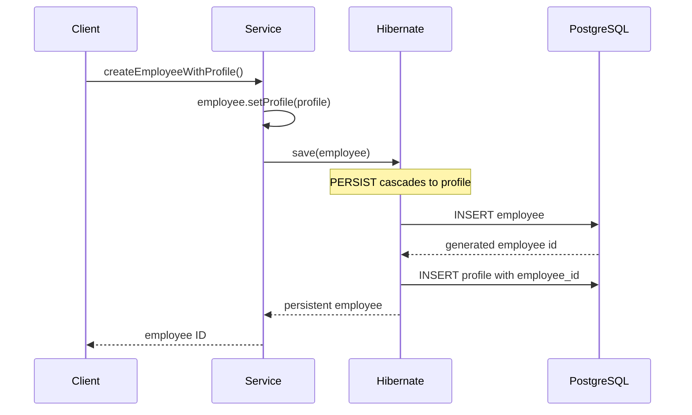

### 4.6 One-to-one update/delete and orphan removal

- Modifying `profile` properties and committing updates the profile row (dirty checking).
- `employee.setProfile(null)` removes the child from the parent's association; because `orphanRemoval=true`, Hibernate can delete the now-orphaned profile on flush.
- Deleting the employee with `CascadeType.REMOVE` (part of `ALL`) propagates deletion to its profile. Use this only if a profile should not outlive its employee.
- To replace a profile, be careful with `UNIQUE(employee_id)` and flush ordering; update the current profile in place or explicitly remove/flush before assigning a new row where necessary.

### 4.7 Shared primary-key alternative (`@MapsId`)

When the profile has exactly the same identity as its employee:

```java
@Entity
class EmployeeProfileSharedId {
    @Id
    private Long id;

    @OneToOne(fetch = FetchType.LAZY, optional = false)
    @MapsId
    @JoinColumn(name = "id")
    private Employee employee;
}
```

Here the profile's `id` is **both primary key and foreign key** to `employees.id`; this is an alternative schema, **not** a drop-in replacement for the earlier table/entity without migrating its schema.

### 4.8 One-to-one test cases

| Case | Action | Expected |
|---|---|---|
| 1:1-T1 | Save Employee with Profile | Two rows; FK points to Employee |
| 1:1-T2 | Load Employee and access Profile | Returns matching profile; SQL may include separate SELECT |
| 1:1-T3 | Create second profile for same Employee | Unique constraint violation |
| 1:1-T4 | Set profile to null and flush | Profile row deleted with orphanRemoval |
| 1:1-T5 | Delete Employee | Profile deleted by cascade and Employee deleted |
| 1:1-T6 | Save profile without required Employee | Fails required association/FK rule |

---

# PART B — ONE-TO-MANY

## 5. `@OneToMany`: Department → Employees

### 5.1 Definition and usage

**One-to-many** means one department can contain multiple employees; each employee belongs to at most one department in this simplified model.

Examples: Department → Employees, Order → OrderItems, Blog → Comments.

### 5.2 Database ER diagram

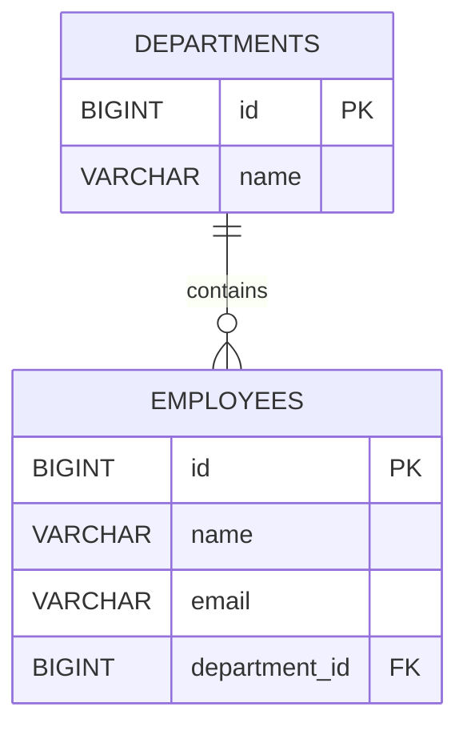

**Critical point:** For the preferred **bidirectional** mapping, the foreign key is in the **many-side table** (`employees.department_id`), not an array stored in the department row.

Example rows:

`departments`

| id | name |
|---:|---|
| 10 | Engineering |
| 20 | HR |

`employees`

| id | name | department_id |
|---:|---|---:|
| 101 | Anil | 10 |
| 102 | Priya | 10 |
| 103 | Ravi | 20 |

### 5.3 Department (inverse side)

```java
package com.javacodeex.department.entity;
import jakarta.persistence.*;
import java.util.*;

@Entity
@Table(name = "departments")
public class Department {
    @Id @GeneratedValue(strategy = GenerationType.IDENTITY)
    private Long id;
    @Column(nullable = false, unique = true)
    private String name;

    @OneToMany(mappedBy = "department", fetch = FetchType.LAZY)
    private List<Employee> employees = new ArrayList<>();

    protected Department() {}
    public Department(String name) { this.name = name; }
    public Long getId() { return id; }
    public String getName() { return name; }
    public List<Employee> getEmployees() { return employees; }

    public void addEmployee(Employee employee) {
        if (employee.getDepartment() == this) return;
        if (employee.getDepartment() != null) {
            employee.getDepartment().employees.remove(employee);
        }
        employees.add(employee);
        employee.setDepartmentInternal(this);
    }
    public void removeEmployee(Employee employee) {
        if (employees.remove(employee)) employee.setDepartmentInternal(null);
    }
}
```

### 5.4 Employee (owning side; many-to-one)

For the Department example, use a **separate demonstration package/project** from the preceding one-to-one example (both show an `Employee` class with different fields/roles). A combined project can merge the mappings into one Employee entity.

```java
package com.javacodeex.department.entity;
import jakarta.persistence.*;

@Entity
@Table(name = "employees")
public class Employee {
    @Id @GeneratedValue(strategy = GenerationType.IDENTITY)
    private Long id;
    private String name;

    @ManyToOne(fetch = FetchType.LAZY)
    @JoinColumn(name = "department_id")
    private Department department;

    protected Employee() {}
    public Employee(String name) { this.name = name; }
    public Long getId() { return id; }
    public String getName() { return name; }
    public Department getDepartment() { return department; }
    void setDepartmentInternal(Department department) { this.department = department; }
}
```

- `Department.employees` uses `mappedBy="department"`, referring to `Employee.department`.
- `Employee.department` owns the relationship because it maps `department_id`.
- Initializing collections (`new ArrayList<>()`) prevents `NullPointerException` before persistence.
- **No cascade in this example**: employees and departments are independent business records; saving one does not implicitly save the other.
- The simple `removeEmployee()` makes an employee's `department_id` NULL; set `nullable=false` and implement reassignment or deletion if employees must always belong to a department.

### 5.5 Save sample data

```java
@Transactional
public void sample(DepartmentRepository departments,
                   EmployeeRepository employees) {
    Department engineering = departments.save(new Department("Engineering"));
    Employee anil = new Employee("Anil");
    Employee priya = new Employee("Priya");
    engineering.addEmployee(anil);
    engineering.addEmployee(priya);
    employees.save(anil);
    employees.save(priya);
}
```

Logical SQL:

```sql
INSERT INTO departments(name) VALUES ('Engineering');
INSERT INTO employees(name, department_id) VALUES ('Anil', 1);
INSERT INTO employees(name, department_id) VALUES ('Priya', 1);
```

### 5.6 One-to-many execution flow

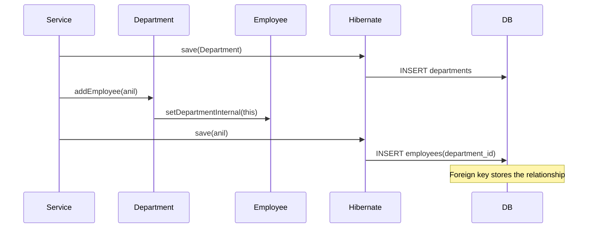

### 5.7 Unidirectional `@OneToMany` alternative

```java
@OneToMany
private List<Employee> employees;
```

Without a `mappedBy` or a `@JoinColumn`, Hibernate/JPA commonly maps a unidirectional one-to-many using an **association/link table**, which is different from the earlier schema. Adding `@JoinColumn(name="department_id")` to a unidirectional one-to-many uses the child table's foreign key instead; the ownership and SQL update patterns differ.

**Teaching recommendation:** For a conventional Department–Employee domain model, prefer bidirectional `Department.@OneToMany(mappedBy=...)` plus `Employee.@ManyToOne`.

### 5.8 One-to-many tests

| Case | Action | Expected |
|---|---|---|
| 1:M-T1 | Save Department with two Employees | Both employees reference same department |
| 1:M-T2 | Load Department and iterate Employees | Two employees returned; collection may trigger SELECT |
| 1:M-T3 | Reassign Employee to HR | `department_id` updated |
| 1:M-T4 | Remove Employee from collection | FK becomes NULL if allowed; row is not automatically deleted |
| 1:M-T5 | Delete Department with existing employees | FK violation unless associations are handled/cascade policies configured |

---

# PART C — MANY-TO-ONE

## 6. `@ManyToOne`: Employee → Department

### 6.1 Definition

**Many-to-one** is the same relationship viewed from the employee's perspective: **many employees can refer to one department**. It is not a separate database relationship from the one-to-many above.

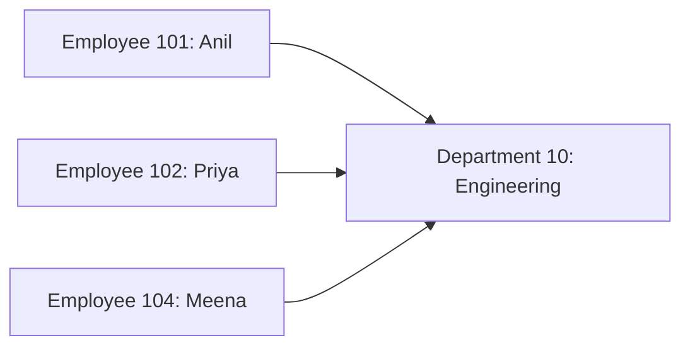

### 6.2 Mapping

```java
@ManyToOne(fetch = FetchType.LAZY, optional = false)
@JoinColumn(name = "department_id", nullable = false)
private Department department;
```

- `@ManyToOne`: many Employee entities reference one Department.
- `fetch=LAZY`: avoid fetching Department until accessed (subject to session/context).
- `optional=false`: relationship must be set in the object model.
- `@JoinColumn`: maps `employees.department_id`.
- `nullable=false`: asks schema generation to make the FK column non-null. Align it with the actual database schema.

**Default gotcha:** JPA defaults `@ManyToOne` to `FetchType.EAGER`; explicitly using `LAZY` is commonly preferable for API services.

### 6.3 Fetch and insert example

```java
@Transactional(readOnly = true)
public String findDepartmentName(Long employeeId) {
    Employee employee = employeeRepository.findById(employeeId)
        .orElseThrow();
    return employee.getDepartment().getName();
}
```

Possible SQL:

```sql
SELECT id, name, department_id FROM employees WHERE id = 101;
SELECT id, name FROM departments WHERE id = 10;
```

Or the provider may use a JOIN if you explicitly request a fetch join or entity graph. **Actual SQL varies** with fetch plans, caches, and provider settings.

### 6.4 Query with JPQL join fetch

```java
@Query("select e from Employee e join fetch e.department where e.id = :id")
Optional<Employee> findWithDepartment(@Param("id") Long id);
```

A fetch join is useful when the use case needs the associated Department immediately. Do not indiscriminately fetch every association.

### 6.5 Many-to-one cases

| Case | Action | Expected |
|---|---|---|
| M:1-T1 | Assign two employees same Department | Allowed; same FK |
| M:1-T2 | Save Employee referencing non-existent Department id | FK violation (or earlier entity-state error) |
| M:1-T3 | Read Employee then Department | Department loaded on demand with LAZY |
| M:1-T4 | Assign null with `nullable=false` | Validation/DB failure |
| M:1-T5 | Delete Employee | Department remains |

**Do not use `CascadeType.REMOVE` indiscriminately on `@ManyToOne`**: deleting one employee should almost never delete a shared Department.

---

# PART D — MANY-TO-MANY

## 7. `@ManyToMany`: Customer ↔ Product

### 7.1 Definition and business example

**Many-to-many** means one customer can be associated with many products, and one product can be associated with many customers.

Example: Alice is interested in Laptop and Mouse; Bob is interested in Laptop and Monitor.

**Domain warning:** Real purchases usually need an `Order` and `OrderItem` entity with quantity, purchase date and price-at-purchase. A direct Customer–Product many-to-many is excellent for teaching or for **favorites/interests** but usually too simple to model purchases.

### 7.2 Database ER diagram and join table

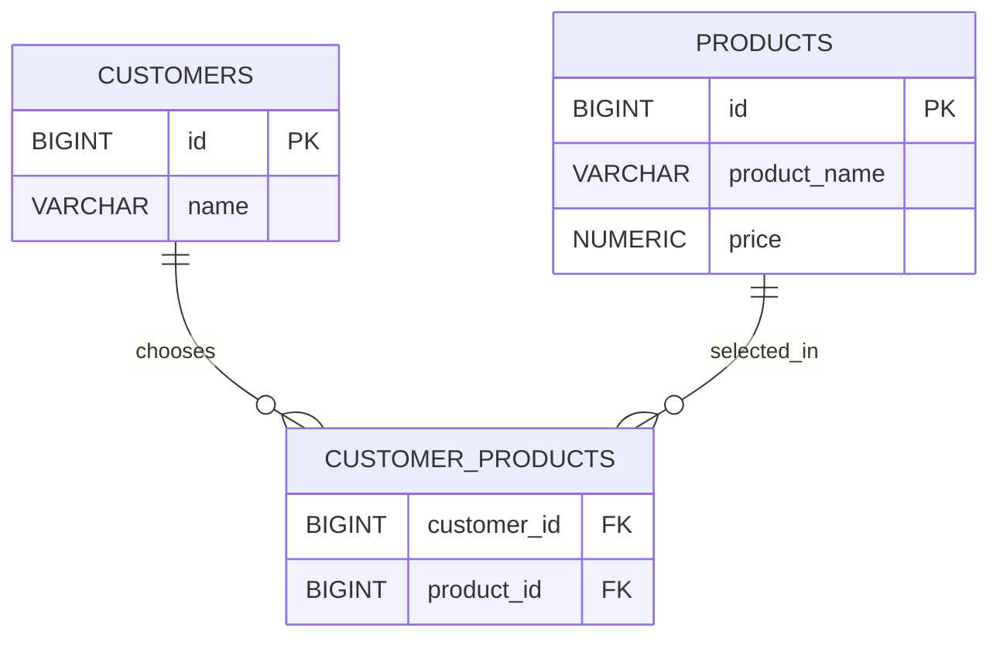

Database sample:

`customers`: `(1, Alice), (2, Bob)`  
`products`: `(10, Laptop), (20, Mouse), (30, Monitor)`

`customer_products`:

| customer_id | product_id |
|---:|---:|
| 1 | 10 |
| 1 | 20 |
| 2 | 10 |
| 2 | 30 |

### 7.3 SQL table design

```sql
CREATE TABLE customers (
    id BIGINT GENERATED BY DEFAULT AS IDENTITY PRIMARY KEY,
    name VARCHAR(100) NOT NULL
);
CREATE TABLE products (
    id BIGINT GENERATED BY DEFAULT AS IDENTITY PRIMARY KEY,
    product_name VARCHAR(100) NOT NULL,
    price NUMERIC(12,2) NOT NULL
);
CREATE TABLE customer_products (
    customer_id BIGINT NOT NULL REFERENCES customers(id),
    product_id BIGINT NOT NULL REFERENCES products(id),
    PRIMARY KEY (customer_id, product_id)
);
```

### 7.4 Customer (owning side)

```java
package com.javacodeex.catalog.entity;
import jakarta.persistence.*;
import java.util.*;

@Entity
@Table(name = "customers")
public class Customer {
    @Id @GeneratedValue(strategy = GenerationType.IDENTITY)
    private Long id;
    private String name;

    @ManyToMany(fetch = FetchType.LAZY)
    @JoinTable(name = "customer_products",
        joinColumns = @JoinColumn(name = "customer_id"),
        inverseJoinColumns = @JoinColumn(name = "product_id"))
    private Set<Product> products = new HashSet<>();

    protected Customer() {}
    public Customer(String name) { this.name = name; }
    public Long getId() { return id; }
    public String getName() { return name; }
    public Set<Product> getProducts() { return products; }

    public void addProduct(Product p) {
        products.add(p);
        p.getCustomers().add(this);
    }
    public void removeProduct(Product p) {
        products.remove(p);
        p.getCustomers().remove(this);
    }
}
```

### 7.5 Product (inverse side)

```java
package com.javacodeex.catalog.entity;
import jakarta.persistence.*;
import java.util.*;

@Entity
@Table(name = "products")
public class Product {
    @Id @GeneratedValue(strategy = GenerationType.IDENTITY)
    private Long id;
    private String productName;
    private Double price;

    @ManyToMany(mappedBy = "products", fetch = FetchType.LAZY)
    private Set<Customer> customers = new HashSet<>();

    protected Product() {}
    public Product(String productName, Double price) {
        this.productName = productName;
        this.price = price;
    }
    public Long getId() { return id; }
    public String getProductName() { return productName; }
    public Double getPrice() { return price; }
    public Set<Customer> getCustomers() { return customers; }
}
```

**Ownership:** `Customer.products` owns the join table because it declares `@JoinTable`; `Product.customers` is inverse with `mappedBy="products"`. Keep both sides synchronized in Java.

**Why `Set`?** It expresses unique associations. In a real application, design stable `equals()`/`hashCode()` carefully; do not base hash codes on mutable generated IDs in a way that breaks collections. This example uses object identity and only demonstrates mapping mechanics.

**Cascade:** Do **not** use `CascadeType.REMOVE` or `ALL` casually here. The same Product can be associated with many Customers; removing one customer must **not** delete the shared product.

### 7.6 Save associations

```java
@Transactional
public void assign(CustomerRepository customers, ProductRepository products) {
    Product laptop = products.save(new Product("Laptop", 65000.0));
    Product mouse = products.save(new Product("Mouse", 900.0));
    Customer alice = new Customer("Alice");
    alice.addProduct(laptop);
    alice.addProduct(mouse);
    customers.save(alice);
}
```

Logical SQL:

```sql
INSERT INTO products(product_name, price) VALUES ('Laptop', 65000.00);
INSERT INTO products(product_name, price) VALUES ('Mouse', 900.00);
INSERT INTO customers(name) VALUES ('Alice');
INSERT INTO customer_products(customer_id, product_id) VALUES (1, 1);
INSERT INTO customer_products(customer_id, product_id) VALUES (1, 2);
```

### 7.7 Many-to-many execution flow

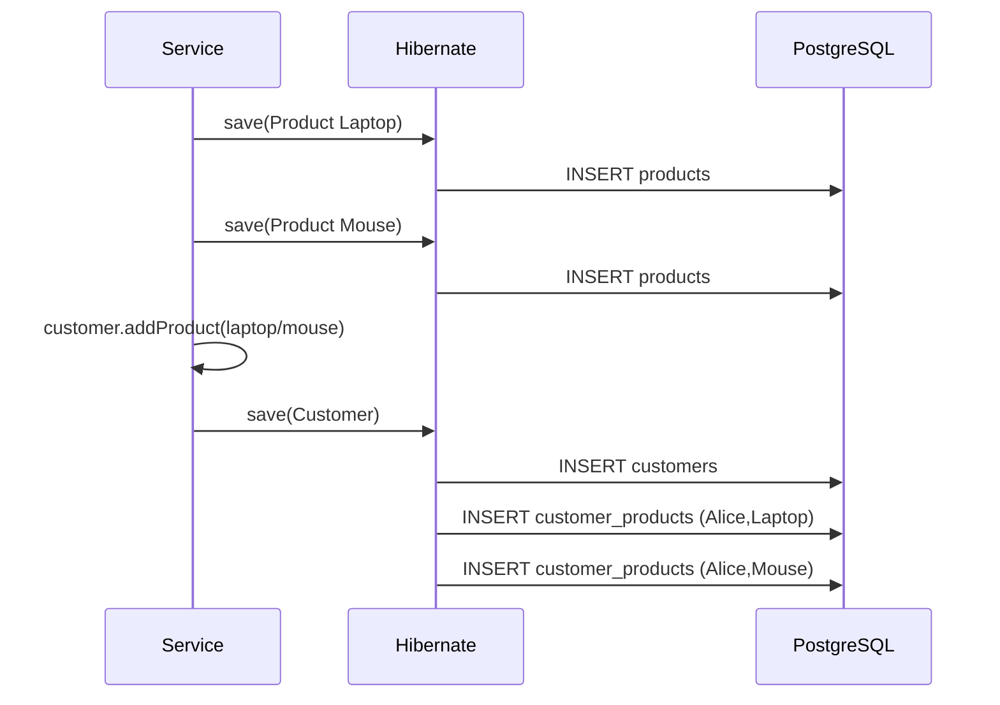

Removing a product from Alice's collection typically removes only a **join-table row**, leaving the `products` table unchanged. Query/flush details vary by collection mapping and Hibernate version.

### 7.8 Many-to-many testing scenarios

| Case | Action | Expected |
|---|---|---|
| M:M-T1 | Customer adds two Products | Two join rows |
| M:M-T2 | Two Customers add same Product | Shared product; two join rows |
| M:M-T3 | Remove product from one Customer | One join row removed; product stays |
| M:M-T4 | Add same Product twice to Set | One association in Java collection |
| M:M-T5 | Load Customer products | Products loaded when collection initialized |
| M:M-T6 | Delete Product still in join table | Must clear links first or configure appropriate DB relationship behavior |

### 7.9 When to use an explicit join entity instead

Use `CustomerProduct` or, for actual commerce, `OrderItem`, when the association has fields such as `quantity`, `addedAt`, `unitPrice`, `status`, or `notes`.

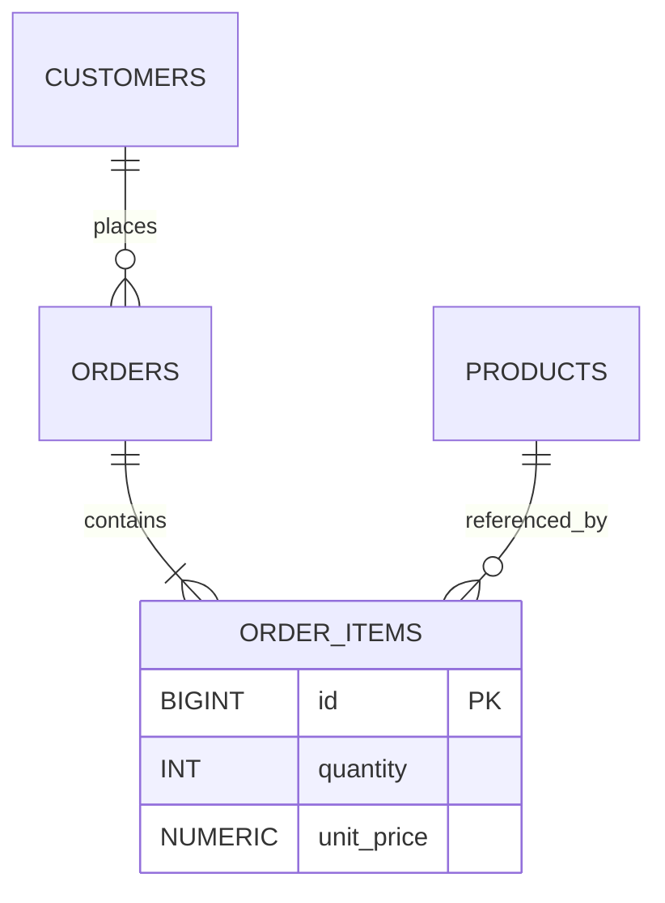

A join entity maps as **two `@ManyToOne` references** and gives you independent control over the association row's lifecycle and attributes.

---

# PART E — ANNOTATIONS AND ATTRIBUTES

## 8. Annotation reference with explanations

| Annotation/attribute | Purpose | Example / caution |
|---|---|---|
| `@Entity` | Marks class as persistent JPA entity | `@Entity` |
| `@Table(name=...)` | Database table name | `@Table(name="employees")` |
| `@Id` | Primary key property | `@Id private Long id;` |
| `@GeneratedValue` | Identifier generation strategy | `GenerationType.IDENTITY` |
| `@Column` | Column properties | `nullable`, `unique`, `length`, `name` |
| `@OneToOne` | One ↔ one association | Employee–Profile |
| `@OneToMany` | One → many collection | Department–Employees |
| `@ManyToOne` | Many → one reference | Employee–Department |
| `@ManyToMany` | Many ↔ many collection | Customer–Products |
| `@JoinColumn(name=...)` | Name of FK column on owning side | `department_id`, `employee_id` |
| `@JoinTable` | Join-table mapping | `customer_products` |
| `joinColumns` | FK column(s) referencing owning entity | `customer_id` |
| `inverseJoinColumns` | FK column(s) referencing other entity | `product_id` |
| `mappedBy` | Java field name on owning side | `mappedBy="department"`; **not a DB column** |
| `cascade` | Propagates JPA operations to related entities | Be cautious with shared references |
| `orphanRemoval` | Deletes a child removed from a privately owned association | Only on `@OneToOne` / `@OneToMany` |
| `fetch` | Fetch timing hint | `LAZY` versus `EAGER` |
| `optional` | Whether a to-one association may be null | `optional=false` |
| `@MapsId` | Child association supplies its primary key | Shared PK one-to-one |
| `@Transactional` | Defines persistence transaction boundary | Service-layer operation |
| `@Query` | Custom JPQL/SQL repository query | Fetch join example |

### 8.1 `mappedBy` explained in depth

```java
// Employee owns the relationship (stores FK)
@ManyToOne
@JoinColumn(name = "department_id")
private Department department;

// Department is inverse; "department" is the field above
@OneToMany(mappedBy = "department")
private List<Employee> employees;
```

- `mappedBy` is **not mandatory for all relationships**.
- It is used on the **inverse side of a bidirectional association**.
- It must match the owning side's Java property exactly.
- Do not use `@JoinColumn` on both ends of the same bidirectional foreign-key association.

### 8.2 Cascade types

| CascadeType | Meaning |
|---|---|
| `PERSIST` | Persist associated entity when parent is persisted |
| `MERGE` | Merge associated entity state |
| `REMOVE` | Propagate remove to associated entity |
| `REFRESH` | Refresh associated entity from database |
| `DETACH` | Detach associated entity from persistence context |
| `ALL` | Includes all listed operations |

**Example:** `Employee` and `EmployeeProfile` often have dependent lifecycles, so `cascade=ALL` can fit. `Employee` and `Department` do **not**, because the Department is shared by many employees.

### 8.3 Cascade REMOVE vs orphanRemoval

- **Cascade REMOVE:** deleting a parent entity cascades removal to associated child entities.
- **`orphanRemoval=true`:** removing an owned child from the parent's association may delete that child's database row, even when the parent remains.
- They solve **different** lifecycle cases; neither should be enabled without considering domain ownership.

### 8.4 Fetch defaults and recommendations

| Association | JPA default | Common API-service recommendation |
|---|---|---|
| `@OneToOne` | EAGER | Consider LAZY; inverse side has caveats |
| `@ManyToOne` | EAGER | Usually specify LAZY |
| `@OneToMany` | LAZY | Usually keep LAZY |
| `@ManyToMany` | LAZY | Usually keep LAZY |

`LAZY` does **not** mean "never query"; accessing the association may trigger a new query. Loading a lazy relationship after the persistence context closes can produce `LazyInitializationException`.

---

# PART F — SQL, EXECUTION, AND PERFORMANCE

## 9. SQL execution and entity lifecycle

### 9.1 Persistence states

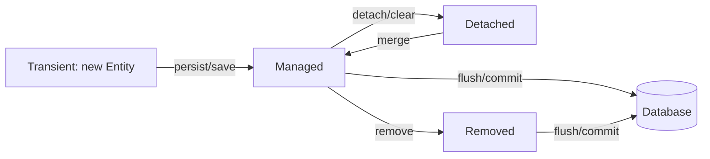

Hibernate tracks managed entities; when a managed object changes inside a transaction, **dirty checking** typically produces UPDATE statements at flush/commit. Operations may flush sooner depending on identifier generation, explicit flushes or queries.

### 9.2 JOIN query example

```sql
SELECT e.id, e.name, d.name AS department_name
FROM employees e
JOIN departments d ON e.department_id = d.id
WHERE e.id = 101;
```

JPQL equivalent:

```java
@Query("select e from Employee e join fetch e.department where e.id = :id")
Optional<Employee> findWithDepartment(@Param("id") Long id);
```

SQL JOINs produce rows; Hibernate maps rows to entities and identity references within the persistence context.

### 9.3 N+1 select problem

If you load 100 employees and then access `e.getDepartment().getName()` in a loop, Hibernate may issue **one query to load employees plus additional queries to load departments** (up to 100 for distinct uncached departments). In this example, if many employees share the same Department, the persistence context can reuse previously fetched Department entities, so the exact number of queries may be lower.

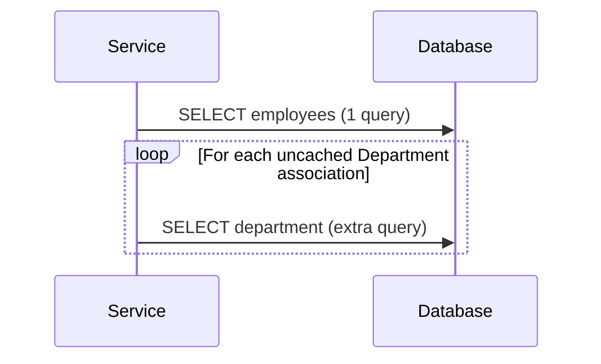

**Mitigations:**

- Use `JOIN FETCH` for known-to-be-needed to-one associations.
- Use `@EntityGraph` on repository methods.
- Consider Hibernate batch fetching where appropriate.
- Use projections/DTO queries when only a subset of columns is required.
- Avoid fetching multiple large to-many collections together; pagination and row multiplication matter.

Example:

```java
@EntityGraph(attributePaths = "department")
@Query("select e from Employee e")
List<Employee> findAllWithDepartment();
```

### 9.4 Why not return entity classes directly from REST APIs?

Bidirectional relations (`Department.employees` and `Employee.department`) can cause recursive JSON serialization, lazy loading outside a transaction, excessive queries and unintended data disclosure.

**Prefer DTO responses**, for example:

```java
public record EmployeeResponse(Long id, String name,
                               Long departmentId, String departmentName) {}
```

Service mapping inside a transaction:

```java
@Transactional(readOnly = true)
public EmployeeResponse getEmployee(Long id) {
    Employee e = employeeRepository.findWithDepartment(id).orElseThrow();
    return new EmployeeResponse(e.getId(), e.getName(),
        e.getDepartment().getId(), e.getDepartment().getName());
}
```

### 9.5 Example REST request and response flow

```text
POST /api/departments
{"name":"Engineering"}
→ 201 {"id":10,"name":"Engineering"}

POST /api/employees
{"name":"Anil","departmentId":10}
→ 201 {"id":101,"name":"Anil","departmentId":10}

GET /api/employees/101
→ 200 {"id":101,"name":"Anil","departmentId":10,
       "departmentName":"Engineering"}
```

These endpoints and responses describe a **suggested controller/DTO implementation**. The earlier repository/entity snippets demonstrate mapping mechanics; they do not by themselves create these HTTP endpoints.

---

# PART G — TESTING PLAN

## 10. Comprehensive manual and integration test scenarios

### 10.1 Database verification queries

```sql
-- One-to-one
SELECT e.id, e.name, p.phone_number, p.employee_id
FROM employees e LEFT JOIN employee_profiles p ON p.employee_id=e.id;

-- One-to-many / many-to-one
SELECT d.name, e.id, e.name
FROM departments d LEFT JOIN employees e ON e.department_id=d.id
ORDER BY d.name, e.id;

-- Many-to-many
SELECT c.name AS customer, p.product_name
FROM customer_products cp
JOIN customers c ON c.id=cp.customer_id
JOIN products p ON p.id=cp.product_id;
```

**Run each query against its corresponding example schema/project**, because the Department example's Employee model and the One-to-One example's Employee model are shown separately.

### 10.2 Full testing matrix

| ID | Relationship | Test | Expected DB / application result |
|---|---|---|---|
| TC01 | 1:1 | Save Employee + Profile | Two rows and valid unique FK |
| TC02 | 1:1 | Attempt duplicate profile for employee | Unique constraint rejection |
| TC03 | 1:1 | Read profile | Correct matching profile |
| TC04 | 1:1 | Remove profile with orphanRemoval | Profile DELETE; Employee stays |
| TC05 | 1:1 | Delete Employee with cascade REMOVE | Related Profile removed |
| TC06 | 1:M | Department with multiple Employees | All child rows have parent FK |
| TC07 | 1:M | Load Department employees | Collection matches database |
| TC08 | 1:M | Move Employee to another Department | FK updates |
| TC09 | 1:M | Delete Department still referenced | Reject without suitable policy |
| TC10 | M:1 | Save Employees under same Department | Same department FK allowed |
| TC11 | M:1 | Null department when non-nullable | Reject |
| TC12 | M:1 | Read Employee with Department | Correct association/navigation |
| TC13 | M:M | Associate Customer with 2 Products | Two join rows |
| TC14 | M:M | Associate second Customer with shared Product | Additional join row; Product not duplicated |
| TC15 | M:M | Remove one Customer–Product association | Join row removed, Product remains |
| TC16 | M:M | Duplicate link attempt | Set/unique join constraint prevents duplicate |
| TC17 | Performance | Loop over lazily loaded references | Observe N+1 risk in SQL logs |
| TC18 | Performance | Use JOIN FETCH/entity graph | Reduce additional association queries |
| TC19 | API | Serialize bidirectional model directly | Demonstrate recursion hazard; fix with DTO |
| TC20 | Transactions | Access lazy association after session closes | Possible LazyInitializationException |

### 10.3 Example integration test: One-to-many FK

```java
@SpringBootTest
@Transactional
class DepartmentMappingTest {
    @Autowired DepartmentRepository departmentRepository;
    @Autowired EmployeeRepository employeeRepository;
    @Autowired EntityManager entityManager;

    @Test
    void employeeShouldBelongToDepartment() {
        Department d = departmentRepository.save(new Department("Engineering"));
        Employee e = new Employee("Anil");
        d.addEmployee(e);
        employeeRepository.save(e);

        entityManager.flush();
        entityManager.clear();

        Employee loaded = employeeRepository.findById(e.getId()).orElseThrow();
        assertEquals(d.getId(), loaded.getDepartment().getId());
    }
}
```

Imports needed: `org.junit.jupiter.api.Test`, `org.springframework.boot.test.context.SpringBootTest`, `org.springframework.transaction.annotation.Transactional`, `org.springframework.beans.factory.annotation.Autowired`, `jakarta.persistence.EntityManager`, and static `org.junit.jupiter.api.Assertions.assertEquals`. This test is intended for the **Department/Employee demonstration project** and requires its repository interfaces and PostgreSQL test database. For repeatable CI tests, consider Testcontainers PostgreSQL.

### 10.4 Recommended execution demonstration sequence

1. Start PostgreSQL and Spring Boot; show empty tables.
2. Save an Employee and Profile; display both INSERT statements and the unique FK.
3. Fetch the Employee and Profile; explain fetching behavior.
4. Remove the profile; demonstrate `orphanRemoval`.
5. Start the Department project; save Department then Employees; show `department_id`.
6. Read Employees by Department; observe LAZY SQL and a JOIN FETCH query.
7. Start Customer–Product demo; create products and customers; inspect join-table rows.
8. Remove a customer-product link; prove the Product remains.
9. Attempt an invalid FK/duplicate one-to-one association; observe constraint failures.
10. Return DTOs from REST endpoints instead of raw entities; explain why.

---

## 11. Benefits, trade-offs, and best practices

### Advantages

- Models business domain relationships naturally.
- Keeps FK relationships consistent with the object model.
- Improves maintainability when navigating connected entities.
- Supports explicit cascade/orphan lifecycle behavior.
- Enables JPQL/HQL and fetch-plan tuning.
- Supports database normalization and referential integrity.

### Limitations / common mistakes

- Treating `mappedBy` as a column name.
- Setting only the inverse side of a bidirectional mapping, leaving the owning side stale.
- Using `CascadeType.ALL` on shared parents or many-to-many associations.
- Setting every relationship to EAGER.
- Returning entities directly as JSON.
- Ignoring N+1 queries and collection row multiplication.
- Assuming `orphanRemoval` equals `CascadeType.REMOVE`.
- Expecting a unidirectional `@OneToMany` to use the same schema automatically.
- Assuming `LAZY` always prevents secondary selects for inverse one-to-one.
- Forgetting FK constraints, indexes and transactional boundaries.

### Practical mapping recommendations

1. Make FK ownership explicit (`@JoinColumn` on child/owning entity).
2. Write helpers that update both sides of bidirectional associations.
3. Prefer lazy relationships; fetch only what each query needs.
4. Keep cascade choices tied to business ownership.
5. Use DTOs at REST boundaries.
6. For many-to-many associations with extra attributes, introduce a join entity.
7. Add FK indexes where query volumes justify them; a PostgreSQL FK does not automatically create an index on the referencing column.
8. Check generated SQL with representative data volumes.
9. Keep write operations transactional.
10. Validate cardinality in the database with FK, UNIQUE and NOT NULL constraints as appropriate.

---

## 12. Interview questions with short answers

**Q1. What is JPA association mapping?** Mapping entity relationships to relational table relationships using JPA annotations.

**Q2. `@OneToMany` vs `@ManyToOne`?** Two directions of a one-to-many relationship; the many-side usually holds the FK.

**Q3. What is an owning side?** The entity property responsible for persisting the relationship (FK or join table).

**Q4. What does `mappedBy="department"` mean?** This side is inverse; the other entity's Java field named `department` owns the mapping.

**Q5. What does `@JoinColumn` do?** Specifies a foreign-key column mapping.

**Q6. What does `@JoinTable` do?** Configures the intermediate relationship table, commonly for many-to-many.

**Q7. Difference between `cascade` and `orphanRemoval`?** Cascade propagates entity operations; orphan removal deletes privately owned children removed from an association.

**Q8. Why avoid `CascadeType.REMOVE` in many-to-many?** The target entity is shared; deleting it could affect other owners.

**Q9. What is LAZY loading?** Loading associated data when needed rather than eagerly by default; behavior depends on mapping/context.

**Q10. What causes N+1?** Additional association queries triggered while iterating a previously fetched list.

**Q11. Can a one-to-one use the same primary key?** Yes, using a shared-primary-key mapping such as `@MapsId`.

**Q12. Why use DTOs?** To control the API shape and avoid cycles, accidental lazy loading and exposing entire entity graphs.

**Q13. Is `mappedBy` mandatory?** No; it is needed on the inverse side of a **bidirectional** mapping.

**Q14. What happens if the FK is invalid?** The database rejects it when FK constraints are enforced.

**Q15. Can the same Department have many Employees?** Yes, multiple employee rows reference the same department key.

---

## 13. Student assignment

Build a **Company HR and Customer Catalog** example with separate feature packages:

- Employees have one EmployeeProfile.
- Departments have many Employees.
- Each Employee belongs to one Department.
- Customers can mark many Products as favorites; Products can belong to many Customers' favorites.
- Provide create/read/update/delete APIs with request/response DTOs.
- Demonstrate unique FK, normal FK and join-table data in PostgreSQL.
- Test `mappedBy`, cascade, `orphanRemoval`, and lazy loading.
- Include a query using `JOIN FETCH` and compare SQL logs with a naive lazy-loading loop.
- Explain why real purchasing should use Order and OrderItem rather than a plain many-to-many.

**Deliverables:** entity classes, repositories, service layer, controllers, Postman requests, screenshots of SQL queries, ER diagrams, and test cases.

---

## 14. Quick revision cheat sheet

```text
@OneToOne    Employee <-> EmployeeProfile    => UNIQUE FOREIGN KEY (or shared PK)
@OneToMany   Department -> Employees        => collection, inverse mappedBy
@ManyToOne   Employee -> Department         => FK on Employee, owns relationship
@ManyToMany  Customer <-> Product           => JOIN TABLE, one owning side

mappedBy       = inverse side's pointer to owning Java field
@JoinColumn    = FK mapping
@JoinTable     = link table mapping
cascade        = propagate operations
orphanRemoval  = remove child disconnected from parent
fetch          = decide when relationship data is loaded
```

## 15. Official references and further reading

1. [Hibernate ORM 6.6 — Introduction, associations](https://docs.hibernate.org/orm/6.6/introduction/html_single/#associations)
2. [Hibernate ORM 6.6 — User Guide](https://docs.hibernate.org/orm/6.6/userguide/html_single/)
3. [Spring Data JPA reference](https://docs.spring.io/spring-data/jpa/reference/)
4. [Jakarta Persistence specification](https://jakarta.ee/specifications/persistence/)

**Note about example independence:** The One-to-One and Department examples intentionally show different small `Employee` classes for easier learning. In a single consolidated application, combine the fields/mappings into one Employee class and use one schema. The SQL shown illustrates logical effects; exact Hibernate SQL statements, statement timing and fetch behavior depend on the configured Hibernate version, mapping, database and transactional context.
